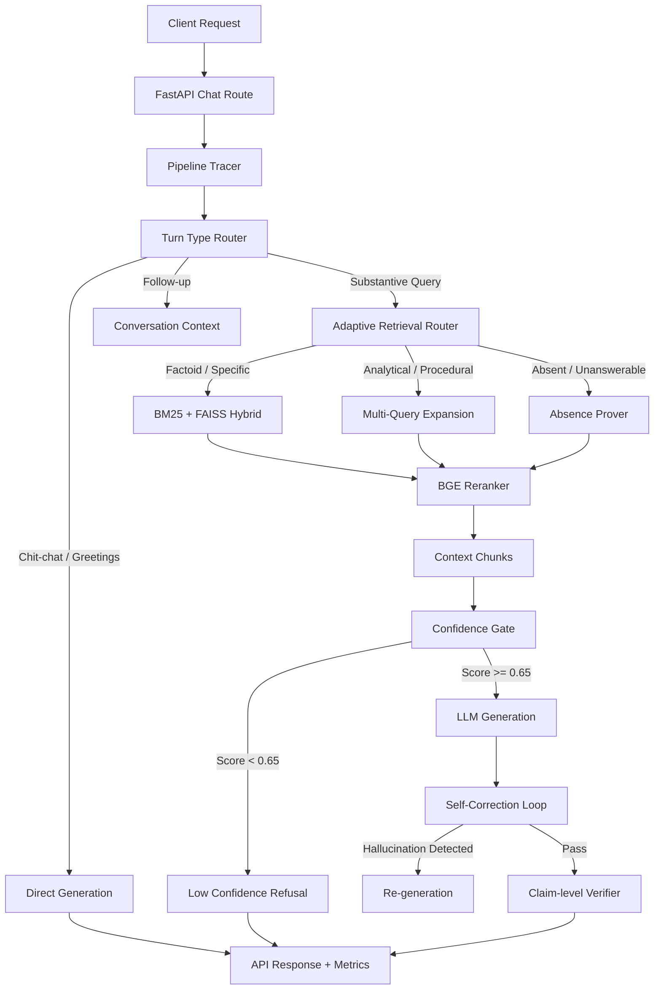
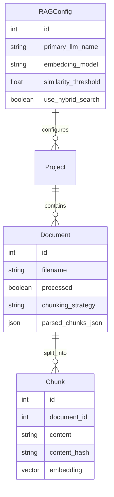

# RAGOps Architecture & Pipeline Design

RAGOps is a production-grade enterprise Retrieval-Augmented Generation system. This document outlines the core architectural components, request lifecycles, and evaluation variants.

## 1. System Architecture Overview

RAGOps is built on a modular pipeline architecture that allows dynamic routing, self-correction, and multiple retrieval strategies based on the complexity of the user's query.

## 2. RAG Variants (Ablation Benchmark)

The system includes a 9-variant benchmark suite (`run_benchmark.py`) to systematically ablate components and measure quality vs latency tradeoffs:

1. **Naive RAG**: Semantic retrieval only (FAISS). No reranker, no query rewriting.
2. **Advanced RAG**: Query rewriting + BGE reranker + adaptive chunking.
3. **Hybrid RAG**: BM25 keyword search + FAISS semantic search fused via Reciprocal Rank Fusion (RRF).
4. **Corrective RAG**: Hybrid + Confidence Gate (preventing hallucinations on missing data) + Self-Correction Loop.
5. **Agentic RAG**: LangGraph retrieval agent with tool-calling, replanning, and multi-step reasoning capabilities.
6. **Full RAGOps**: The complete production pipeline with all stages enabled (cache, cost control, claim verification).
7. **Adaptive RAGOps**: The Full RAGOps pipeline enhanced with the Adaptive Retrieval Router for dynamic backend dispatching.
8. **Policy-Driven RAGOps**: Next-Gen Policy-Driven Adaptive AI Runtime with typed ExecutionPlan, budget constraints, early exits, and adaptive top-k.
9. **Late-Chunked RAGOps**: Long-context token-pooling Late Chunking strategy isolated from pre-embedding Contextual Retrieval blurbs.

## 3. Database Schema

The persistence layer uses PostgreSQL with SQLModel/SQLAlchemy.

## 4. Empirical Performance (Local CPU / Open-Source Benchmark)

*Note: Results derived from `openai/gpt-oss-20b` (Groq) and `all-MiniLM-L6-v2` (Local HF)*

| Variant | Overall Quality | Latency | Risk / Faithfulness |
|---------|-----------------|---------|---------------------|
| **Advanced RAG** | **0.425** | 7.10s | 0.526 |
| **Adaptive RAGOps** | 0.370 | **6.91s** | 0.462 |
| **Agentic RAG** | 0.368 | 7.08s | 0.433 |
| **Policy-Driven** | 0.359 | 7.16s | 0.446 |
| **Naive RAG** | 0.357 | 8.50s | 0.431 |

*The Adaptive router efficiently cuts down processing time while retaining high faithfulness compared to the baseline Naive model.*
