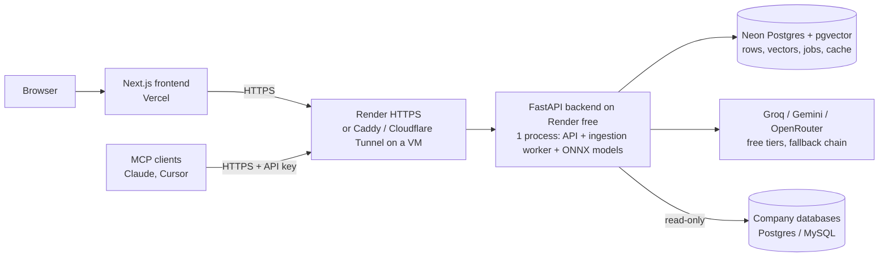
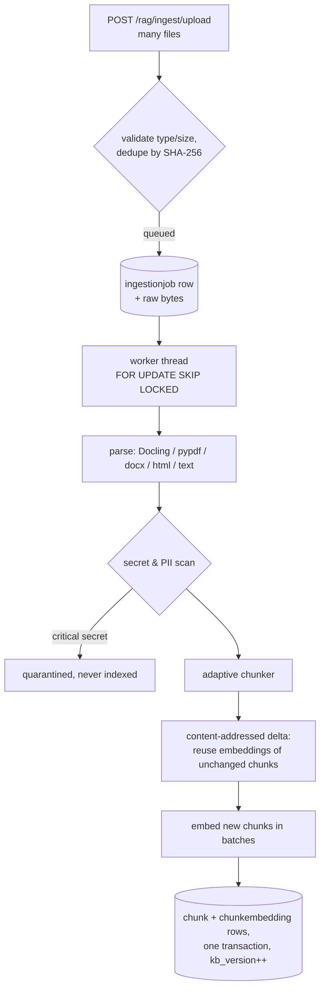
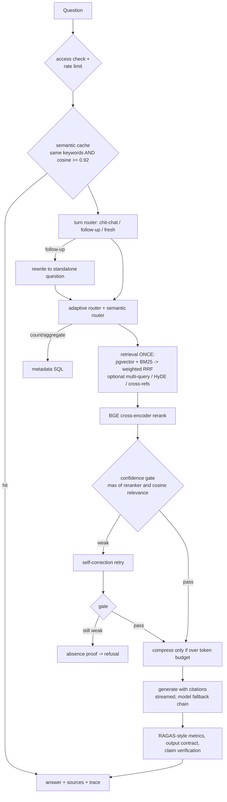

# RAGOps Architecture

RAGOps is a multi-project RAG platform. Each project has its own documents, connected
databases, members, API keys and a fully configurable retrieval/generation pipeline.

## 1. Deployment topology

One backend process holds the local models (MiniLM embeddings and an ms-marco MiniLM
cross-encoder on ONNX Runtime by default, or bge-reranker-base with `MODEL_BACKEND=torch`) in memory once and
serves requests from a thread pool; background worker threads process the job queue.
All state lives in Postgres, so restarts and redeploys lose nothing.

## 2. Ingestion

## 3. Question answering (one chat turn)

Key properties:
* The chunks placed in the prompt are exactly the chunks cited, shown as sources and
  scored by every metric.
* Relevance is calibrated: cross-encoder logits are mapped to [0, 1] from measured
  relevant/irrelevant pairs, and combined with bi-encoder cosine (max) so paraphrases
  are not rejected. Default gate threshold 0.40 (per-project override).
* Every stage can be switched on/off per project; the trace records what ran and how long
  each phase took (`/executions`).

## 4. Ask-your-database

Manager connects a database (read-only user recommended) and selects exposed tables.
Questions go: write-intent guard -> table selection (BM25 over schema) -> LLM writes SQL ->
sqlglot AST validation (single SELECT, no writes / `SELECT INTO` / locking / dangerous
functions, allow-listed tables only, enforced LIMIT) -> read-only session with statement
timeout -> one automatic repair attempt on SQL errors -> answer summarised from the rows,
with the SQL and rows shown to the user. Hosts resolving to private/internal addresses are
rejected (SSRF protection).

## 5. Data model (main tables)

| Table | Purpose |
|---|---|
| `project`, `projectmember` | projects, visibility, viewer/editor members |
| `ragconfig` | versioned per-project pipeline configuration |
| `document`, `chunk` | uploaded files and their chunks |
| `chunkembedding` | one vector per (chunk, embedding model), pgvector |
| `ingestionjob` | durable work queue |
| `semanticcacheentry` | answer cache scoped to (project, kb_version, model) |
| `externaldatabase` | connected databases (Fernet-encrypted credentials) |
| `projectapikey` | hashed API keys for MCP / programmatic access |
| `chatsession`, `message`, `querylog`, `tokenusage` | conversations, traces, analytics |

Schema upgrades are additive and automatic on startup (`app/db.py`); one-time data fixes
are tracked in `schema_migrations`.

## 6. Benchmark variants

`run_benchmark.py` / AutoRAGBench ablates the pipeline across 10 variants (naive, advanced,
hybrid, corrective, agentic, full, adaptive, policy-driven, late-chunking, ...) with
RAGAS-style metrics; see the README for results and caveats.
